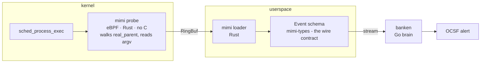

# mimi

**mimi** (耳, "ears") is the eBPF telemetry sensor for [banken](https://github.com/conor-sometimes/banken)
(番犬, "watchdog"). It watches the kernel - process execs today, file and network next - and emits
structured events for banken to detect on. A separate binary from banken, so **banken-core stays
pure-Go with no kernel component**: the kernel-adjacent, `unsafe`-by-nature part lives here, in Rust,
where the unsafe is small, marked, and checked by the kernel's BPF verifier.

Status: **working PoC, graduating to the banken bar.** What runs today: a Rust + [aya](https://aya-rs.dev)
program that loads on a live 6.18 kernel, attaches to `sched_process_exec`, and for every exec emits
the process's argv plus its full ancestry (walking `task_struct->real_parent` to pid 1). One
self-contained binary - aya embeds the BPF object - **no C**: the probe and the loader are both Rust.

## Architecture



mimi and banken are **decoupled**: they speak a wire schema, not linked code, so the sensor is
swappable (mimi, or Falco/Tetragon via an adapter) and banken never grows a kernel component. The
schema is the contract (`mimi-types`), and it maps onto banken's OCSF-shaped `process` /
`parent_process` objects - the same nested-process model every EDR uses.

banken consumes mimi as a **continuous stream** (not a polled log), so end-to-end detection latency
is *capture + match*, not bounded by any scan interval - two independently-timed components would
compound latency ("miss the bus"). Events carry a capture timestamp (`time_ns`) so that latency is a
measured number.

## Event schema (`mimi-types`)

One `#[repr(C)]` layout shared no_std by the probe and std by the loader, so the two halves can never
disagree on the bytes. An event is a process with its argv and its ancestry; the loader renders it as
familiar fields:

```
process.name=ping process.pid=213541 process.cmdline="ping 8.8.8.8"
process.parent.name=fish process.parent.pid=210139
process.ancestry=fish(210139) < sshd-session(210138) < sshd(196136) < systemd(1)
```

One level of `process.parent` is the standard (OCSF `parent_process`, SentinelOne `parent`); the full
chain is a single `process.ancestry` path, not `.parent.parent.parent` nesting.

## Dependencies

Every dependency is audit surface, so the bar is hardening/function value vs the cost of auditing its
whole tree. mimi keeps **`aya`** (the loader), **`anyhow`** (error context in a root daemon) and
**`libc`** (the memlock bump); the aya template's `tokio`/`clap`/`log` freeloaders are stripped.
Versions are exact-pinned, `Cargo.lock` is committed, Dependabot proposes bumps, and `cargo-deny`
(`deny.toml`) gates advisories, licenses and sources. `just tree` prints the audit surface.

## Toolchain

The **userspace builds on stable**; only the **probe needs a pinned nightly**, because the BPF target
has no prebuilt `core`, so aya builds it from source with `-Z build-std` (nightly-only). The nightly
is pinned (`rust-toolchain.toml`) - frozen, reproducible - and its LLVM must match the `bpf-linker`
mimi links with. nixpkgs' prebuilt `bpf-linker` lags, so build `bpf-linker 0.12` against nixpkgs'
LLVM 23 (with `libLLVM.so` from the `lib` output on the linker path); see the build notes / the
`mimi` [workbench](https://github.com/conor-sometimes/workbench) toolchain.

## Build and test

```sh
just            # the gate: fmt + clippy + test + cargo-deny
just test       # unit tests of the schema + parse/render logic (no kernel)
just build      # full build: compiles the probe and embeds it
just run        # build + run (needs root to load the probe)
```

## Portability

The PoC reads `task_struct` by hardcoded offsets, so it runs on exactly its build kernel. The
first-class sensor uses **CO-RE** (relocate the offsets against each kernel's BTF at load) so one
binary runs on any BTF-capable kernel - which is what the planned **live distro matrix** (boot each
distro's own kernel, load mimi, assert it captures an exec) both requires and proves.

## License

MIT. mimi links aya, which is dual MIT / Apache-2.0.
